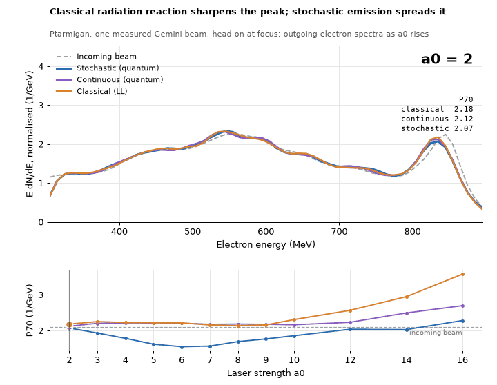
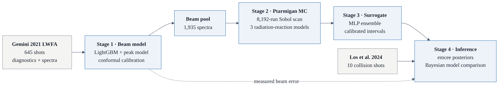
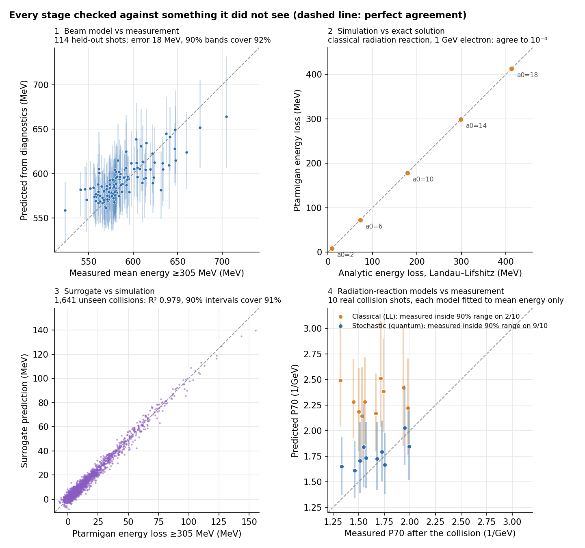
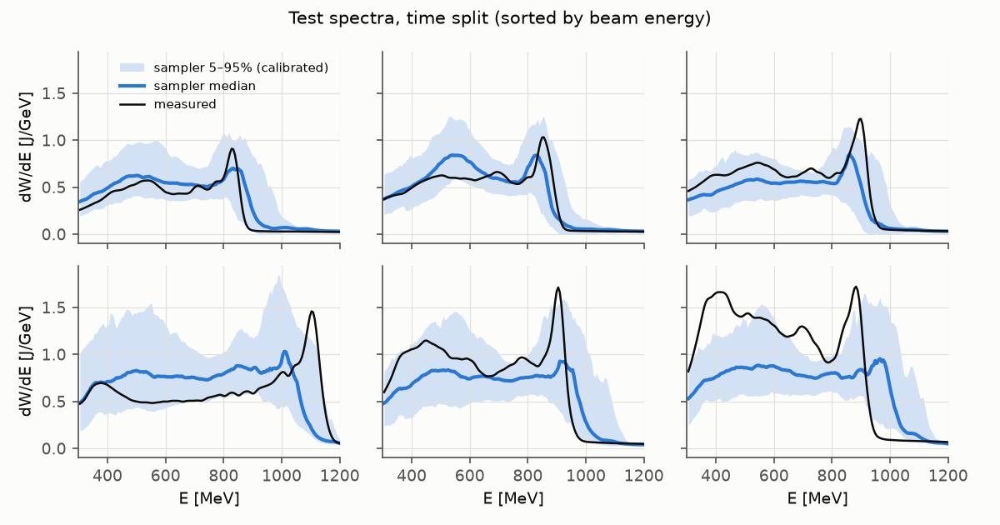
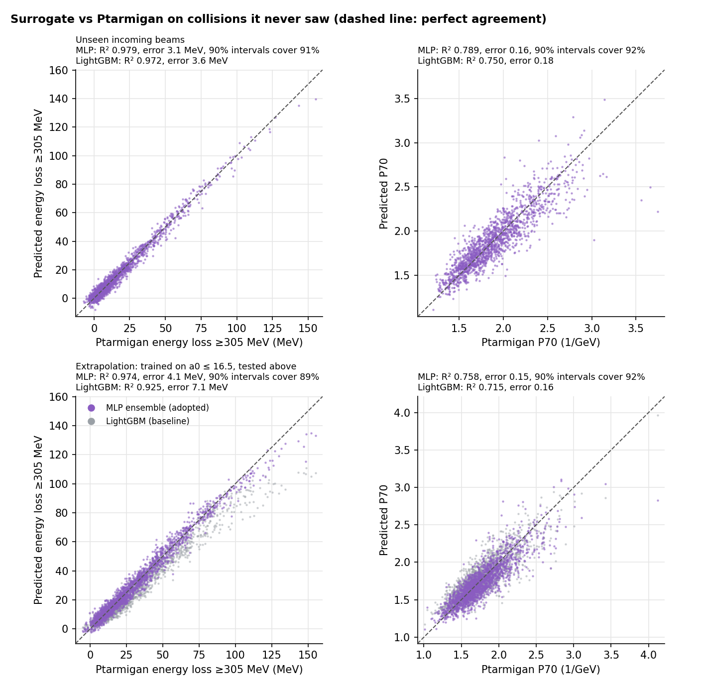
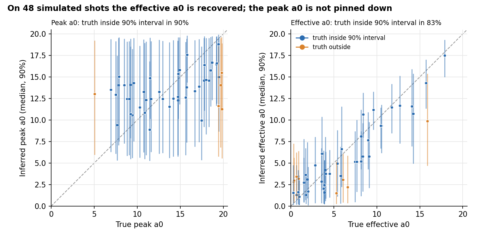
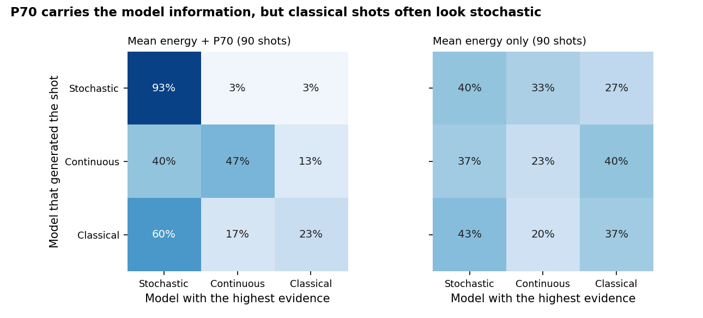
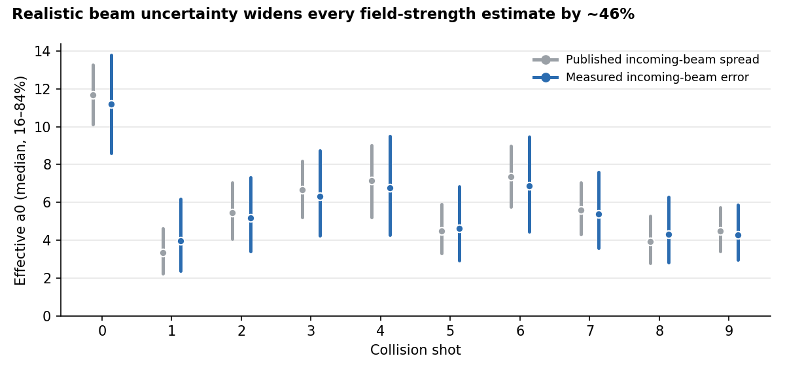
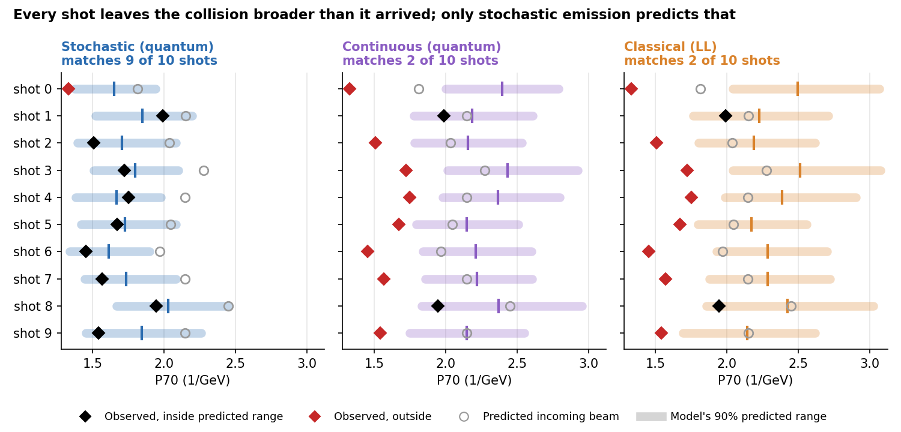
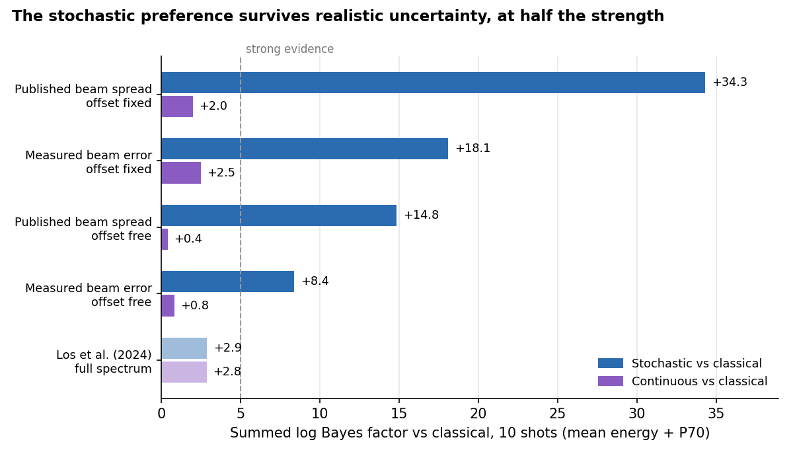

# ML-SFQED

**Calibrated machine learning and simulation-based inference for strong-field QED experiments**

[](https://github.com/liudi23/ml-sfqed/actions/workflows/ci.yml)

In this project we build an end-to-end pipeline that turns raw data from a strong-field QED experiment into fast, calibrated Bayesian inference. It is applied to the 2021 radiation-reaction experiment at the Gemini laser, where a laser-wakefield electron beam collides with an intense laser pulse and the change in the electron spectrum shows how electrons radiate when quantum effects matter. The pipeline chains a machine-learning model of the incoming electron beam, Ptarmigan QED Monte Carlo simulations, a neural surrogate of those simulations, and Bayesian inference on the public collision shots.

**What goes in, what comes out.**

| | |
| --- | --- |
| **Built once per campaign from** | no-collision shots (laser and plasma diagnostics + measured electron spectrum; 645 Gemini shots) to train the beam model; Ptarmigan simulations for each radiation-reaction model (8,192 + 2 × 4,096 collisions) to train the surrogates; fixed experimental settings (laser waist and duration, beam size, spectrometer resolution) |
| **Input per collision shot** | the shot's laser and plasma diagnostics, turned into predicted incoming spectra by the beam model (for the 2021 data the collision-shot diagnostics are not public, so Los et al.'s published predictions are used, widened to our measured error); the measured outgoing electron spectrum |
| **Output per collision shot** (under a minute on a laptop) | the effective laser strength a0 the electrons experienced, the timing offset from focus, bunch length and optionally the sideways offset, all with uncertainty; the evidence for stochastic, continuous and classical radiation reaction (Bayes factors per shot and summed); each model's predicted observables with intervals, to check the fit against the measurement |
| **Reusable parts** | the beam model (diagnostics → electron spectrum with calibrated uncertainty), useful to laser-wakefield teams on its own; the surrogate (collision parameters + incoming beam → Ptarmigan's observables, about a million times faster) |

**Problems it solves.**

- **Cost of the analysis.** For strong-field QED experiments (Gemini, LUXE, E-320, ZEUS): every collision shot can be analysed, not only the brightest; the analysis can be rerun under different assumptions; parameters fixed for cost can be freed; and it is fast enough to run between shots during a campaign.
- **Trust in the conclusion.** Every uncertainty is measured on data the model did not see. On the 2021 data this turns a strong published preference into a still-clear but smaller one.
- **Knowing what the data can tell you.** Tests on simulated shots show which quantities a measurement pins down (here the effective field and, through P70, the radiation-reaction model, but not the peak field), which helps decide what a future experiment should measure.
- **Predicting the beam.** Laser-wakefield operators get a predicted spectrum with honest error bars for shots where the beam cannot be measured directly.

**Why it is better than the existing analysis** (Los et al. 2024, direct simulation in the likelihood): one shot takes **42 CPU-seconds instead of ~19,200 CPU-hours**, which makes recovery tests, extra free parameters and sensitivity studies affordable; the incoming-beam uncertainty is **measured on held-out shots** rather than taken from the network ensemble (it is ~3× larger); the beam prediction itself is more accurate; and every stage is checked on data it never saw.

**Limitations.** The likelihood uses two summary observables of the electron spectrum and not yet the gamma-ray data; a full-spectrum likelihood is the next step. It is trained for the Gemini 2021 set-up: a new experiment needs its own beam data and simulation scan, though the code carries over. See [Limitations and next steps](#limitations-and-next-steps).

<p align="center">
  
</p>

## Key results

| | |
| --- | --- |
| **~1.6 million× faster inference** | A full Bayesian fit of one collision shot takes **42 CPU-seconds**, against ~19,200 CPU-hours with direct simulation (Los et al. 2024). |
| **Published beam uncertainty is ~3× too narrow** | The incoming-beam error measured on held-out shots (P70 0.26, mean energy 18.1 MeV) is 2.4–2.8× the published per-shot spread (0.11, 6.4 MeV). Using it widens the field-strength estimates by ~46% and cuts the stochastic-vs-classical Bayes factor by ~40%. |
| **Spectral broadening favours stochastic quantum radiation reaction** | On all 10 shots the outgoing spectrum is broader than the incoming one. Only stochastic emission reproduces this: the measured P70 falls inside its 90% predicted range on 9 of 10 shots (the tenth just outside), against 2 of 10 for classical and continuous models. Summed log Bayes factor over classical: **+20** with realistic beam uncertainty (+34 with the published spread). |
| **Better beam prediction, with honest uncertainty** | Spectral MSE **0.045 vs 0.057** for the published network ensemble (22% lower), with a physics-based peak shape; calibrated 90% intervals cover 89–90% of held-out shots (raw ensembles: 44–68%). |
| **Accurate surrogate** | MLP ensemble reproduces Ptarmigan to R² 0.98 (energy loss) at ~2× its Monte Carlo noise; ~18,000× faster per call, ~4×10⁶× batched. |

Two-page summary: **[docs/summary.md](docs/summary.md)** · full write-up: **[docs/report.md](docs/report.md)**.

## Pipeline

<p align="center">
  
</p>

<sub>Diagram source: <code>docs/figures/pipeline.mmd</code> (render with <code>mmdc -i docs/figures/pipeline.mmd -o docs/figures/pipeline.png -s 3 -b white</code>).</sub>

Every stage's uncertainty is checked on data it never saw: conformal calibration and coverage tests (stages 1 and 3), validation against analytic limits (stage 2), and recovery tests on simulated shots with known answers plus posterior predictive checks (stage 4).

## Results

### How each stage is checked



Each panel compares a stage's prediction with something it did not see (dashed line: perfect agreement). (1) The beam model's predicted incoming mean energy against the measured value on 114 shots of a later run. (2) Ptarmigan's energy loss against the exact Landau–Lifshitz solution. (3) The surrogate against Ptarmigan on 1,641 collisions with unseen beams. (4) On the 10 real collision shots, the P70 each radiation-reaction model predicts after being fitted to the mean energy alone, against the measured P70: the classical predictions sit far above the line, the stochastic ones on it. For real shots the true laser strength is unknown, so panel 4 (a prediction of a measured quantity) and the recovery tests on simulated shots below are how Stage 4 is checked.

### Stage 1: beam prediction from diagnostics

| Split | Model | Spectral MSE | Beam-energy error | 90% coverage |
| --- | --- | --- | --- | --- |
| authors' random split | Streeter et al. network ensemble | 0.057 | 12.4% | – |
| authors' random split | **Square-root-edge peak model (this work)** | **0.045** | 12.5% | 0.89 |
| time split (held-out last run) | **Square-root-edge peak model (this work)** | **0.030** | 14.7% | 0.90 |

Each spectrum is modelled as a continuum plus a **physics-based peak**: near dephasing, electrons pile up below the maximum energy E_max as dN/dE ∝ (E_max − E)^(−1/2) (phase-space rotation), smeared by resolution and bunch spread. This shape fits the measured peaks 4.4× better than a Gaussian with the same three parameters, and its parameters are physical: E_max is the dephasing-limited maximum energy. E_max is predicted by a LightGBM ensemble averaged with a Gaussian process, whose errors differ (position error −10% on the selection run). The thick line is the spectrum at the predicted edge (~97% of the measured peak height); the remaining misses are mostly peak position, which the diagnostics only partly determine.

**Why two splits.** The *random* split (the authors' 570/75) is kept only to compare with Streeter et al. The *time* split (train on runs 05–12, test on run 13, the last run of the day) is the honest test: it asks whether a model trained on earlier shots can predict later ones, which is how it is used for collision shots. It matters because the beam drifts (mean beam energy 0.90 J in run 05, 0.52 J in run 13) and neighbouring shots are alike, so a random split tests the model inside conditions it has already seen. On the time split the beam-energy error is larger (14.7% vs 12.5%; plain LightGBM 18.9% vs 14.9%), but the calibrated 90% intervals still cover 90%. The incoming-beam error used in the inference is measured on run 13, and model choices were made on run 11 (trained on runs 05–10) before run 13 was touched. Spectral MSE is lower on run 13 only because its spectra vary less; MSE is comparable within a split, not across splits.



### Stage 2: validated QED Monte Carlo

Ptarmigan v1.6.1 reproduces analytic limits to ≤1%: classical Landau–Lifshitz energy loss (to 10⁻⁴), linear Compton yield scaling (a0²) and the Klein–Nishina-corrected energy loss. The training scan is 8,192 collisions on a Sobol design over a0 (5–20), timing, transverse offset, laser waist and duration, and beam size, with incoming spectra drawn from the Stage 1 beam pool; 4,096 of them were repeated with classical and quantum-continuous radiation reaction (same seeds). The animation at the top is from this simulation.

### Stage 3: surrogate accuracy on unseen beams

| Observable | R² | Error / MC noise | 90% coverage, raw → calibrated |
| --- | --- | --- | --- |
| Mean energy loss (≥305 MeV) | 0.979 | 2.1 | 0.74 → 0.91 |
| Spread P70 | 0.79 | 2.0 | 0.79 → 0.92 |
| Photon critical energy | 0.983 | 1.8 | 0.86 → 0.90 |
| log₁₀ photons per electron | 0.994 | 6.5 | 0.94 → 0.90 |

P70's lower R² reflects its small spread relative to Monte Carlo noise (ceiling ~0.95), not a worse fit.



Top: collisions whose incoming beams the surrogate never saw. Bottom: trained on a0 ≤ 16.5 and tested above, with the LightGBM baseline in grey. In energy loss the trees flatten off at large loss and the MLP does not. P70 scatters more, at about twice its Monte Carlo noise, and its largest values (above ~2.6) are predicted too low. The measured collision shots sit at 1.3–2.0, where the average offset is only +0.03.

### Stage 4: inference and model comparison on the 10 collision shots

Each shot is fitted to its outgoing mean energy and P70 with the incoming beam marginalised over 50 predicted spectra, in **42 CPU-seconds** (emcee, surrogate in the likelihood). On 48 simulated shots with known answers the 90% intervals contain the true a0 90% of the time; on 90 simulated shots the model comparison identifies stochastic data 93% of the time.

#### Checks on simulated shots with known answers



Only the effective a0 is recovered; the peak a0 at focus stays close to its prior, because a stronger laser slightly off the beam gives the same energy loss.



With P70, stochastic shots are identified 93% of the time; with mean energy alone the comparison is no better than chance. Classical shots often come out marginally stochastic, but only by small margins (median log Bayes factor +0.3, never above +1.2): ten classical shots would sum to about −3 and ten stochastic shots to about +7. The real data give **+9** in the same set-up (sideways offset free), close to the stochastic expectation.

The simulated shots are held-out Ptarmigan runs, not surrogate output, so surrogate error is included. They are an easier test than the real shots in two ways: each is fitted with its true incoming beam, and the laser waist, duration, beam radius and divergence are fixed at their true values.

#### Realistic beam uncertainty widens every field-strength estimate



With two summary observables only the effective a0 (the field the electrons experience) is constrained. Using the measured beam error instead of the published spread widens its intervals by ~46% (26% with the transverse offset free).

#### Spectral broadening separates the radiation-reaction models

Each model is fitted to the outgoing mean energy alone, then asked to predict P70, a measure of how sharp the spectral peak is. Only stochastic emission predicts the observed broadening:



A dedicated diagnostic (`scripts/diagnose_p70.py`) rules out a definition artefact, out-of-distribution beams and surrogate error, using direct Ptarmigan runs at the fitted parameters.

#### The evidence depends on how honest the beam uncertainty is



The stochastic preference drops by ~40% once the measured beam error replaces the published spread (+34 → +20), and roughly halves again when the transverse offset is also free (+9), a parameter the original analysis had to fix for cost. Energy loss alone carries no model information, because a free a0 absorbs the difference.

## Limitations and next steps

- Inference uses two summary observables, which constrain only the effective field strength. A **full-spectrum likelihood** that models the incoming spectrum's shape error is the next step, and the confirmation test for the stochastic preference.
- Gamma-ray data are not used yet. Los et al.'s effective field strength ⟨ã0⟩ (the mean a0 experienced by the electrons in their model) is 6.7–9.4 on nine shots; ours is mostly 4–7. A direct Ptarmigan check (`scripts/a0_consistency_check.py`) agrees with theirs to about 1 on the three shots with 34–43 MeV energy loss. On the five low-loss shots the electron spectrum cannot pin a0 (the loss is within 1–1.5× the 18 MeV incoming-beam error), and Los et al. also fit the gamma-ray signal. Adding it needs their gamma spectrometer forward-modelled first.
- About 30% of each beam's energy is in a secondary electron population that the diagnostics cannot predict, which sets a floor on the beam-model error.
- Laser waist, duration, beam radius and divergence are fixed in inference.

## Reproduce

```bash
uv venv && uv pip install -e ".[dev]"
bash scripts/install_ptarmigan.sh                  # Ptarmigan v1.6.1 (Rust)
# Gemini data: put the two .pkl files from doi:10.5281/zenodo.7510352 in data/raw/
bash scripts/fetch_los2024.sh                      # Los et al. collision data (local only)

python scripts/run_stage1.py                       # Stage 1 beam model           -> results/stage1/
python scripts/validate_ptarmigan.py               # Stage 2 validation          -> results/ptarmigan_validation/
python scripts/stage2_scan.py design && python scripts/stage2_scan.py run && python scripts/stage2_scan.py collect
                                                   # ~45 min per 4,096 collisions on 12 cores; `extend` adds more
for m in classical continuous; do                  # same collisions with the other radiation-reaction models
  python scripts/stage2_scan.py --model $m run --limit 4096 && python scripts/stage2_scan.py --model $m collect
done
python scripts/stage3_surrogate.py && python scripts/stage3_learning_curve.py   # Stage 3 metrics -> results/stage3/
python scripts/stage3_train_final.py               # surrogate used for inference
for m in stochastic classical continuous; do python scripts/stage3_train_final.py --model $m --max-runs 4096; done
python scripts/beam_prediction_error.py            # measured incoming-beam error
python scripts/infer_los2024.py recovery --n 48 && python scripts/infer_los2024.py shots
python scripts/compare_models.py recovery --n 30 && python scripts/compare_models.py shots
python scripts/diagnose_p70.py                     # P70 diagnostics             -> results/diagnostics/p70/
python scripts/a0_sweep.py && python scripts/make_figures.py   # figures in docs/figures/
python scripts/a0_consistency_check.py             # direct Ptarmigan check of a0 vs Los et al.
```

Runs are seeded and LightGBM is single-threaded, so results are deterministic.

## Repository layout

```
src/mlsfqed/
  data/          Gemini loaders, splits, features
  beam_model/    Stage 1 models, peak fits, calibration, online adaptation
  simulation/    Ptarmigan wrapper, observables, Sobol design
  surrogate/     scan -> features/targets, MLP and tree surrogates
  inference/     Los et al. data, likelihood, posterior, evidence
scripts/         one script per step (see Reproduce)
results/         metrics, figures and validation runs
docs/            summary.md (2 pages), report.md (full), roadmap.md, figures/
tests/           data-free unit tests (peak shape, observables, surrogate), run in CI with ruff
```

## Data and references

- **Gemini LWFA data:** M. J. V. Streeter et al., *Laser wakefield accelerator modelling with variational neural networks*, High Power Laser Sci. Eng. 11, e9 (2023), [doi:10.1017/hpl.2022.47](https://doi.org/10.1017/hpl.2022.47). Data: [doi:10.5281/zenodo.7510352](https://doi.org/10.5281/zenodo.7510352) (CC BY 4.0).
- **Collision shots and model evidences:** E. E. Los et al., *Observation of quantum effects on radiation reaction in strong fields*, Nature Communications, [doi:10.1038/s41467-025-67918-8](https://doi.org/10.1038/s41467-025-67918-8) ([arXiv:2407.12071](https://arxiv.org/abs/2407.12071)); E. E. Los et al., *A Bayesian framework to investigate radiation reaction in strong fields*, High Power Laser Sci. Eng. (2024), [doi:10.1017/hpl.2024.83](https://doi.org/10.1017/hpl.2024.83). Public data from [ELos385/RadiationReaction](https://github.com/ELos385/RadiationReaction), fetched locally and not redistributed here; figures show derived quantities.
- **Ptarmigan:** T. G. Blackburn et al., Phys. Plasmas 30, 093903 (2023).

## Licence

Code under the [MIT licence](LICENSE); see [CITATION.cff](CITATION.cff) to cite it. The Gemini data are CC BY 4.0 (Streeter et al.); the Los et al. collision data are not redistributed.

## Author

Di Liu, formerly postdoctoral researcher in strong-field QED, University of Plymouth. Project plan and progress: [docs/roadmap.md](docs/roadmap.md).
