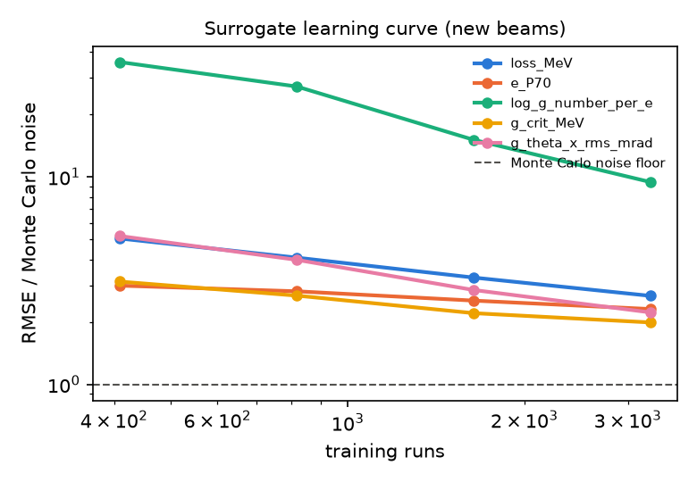
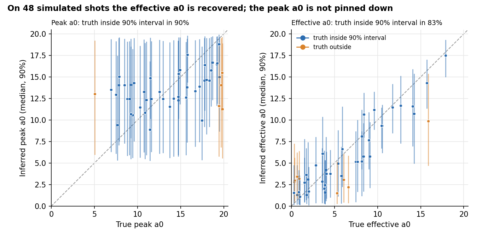
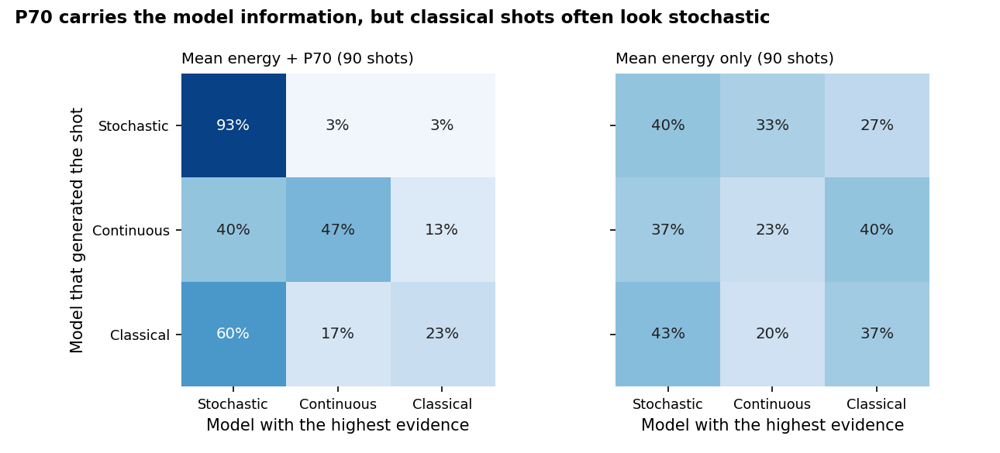
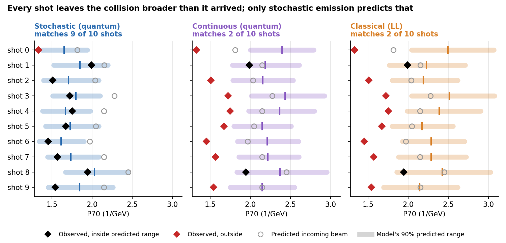

# ML-SFQED: calibrated beam models and fast inference for strong-field QED

Di Liu · November 2026 · code: this repository

## Summary

In this project we build an end-to-end pipeline that turns raw data from a strong-field QED experiment into fast, calibrated Bayesian inference. The target is the radiation-reaction experiment at the Gemini laser (2021): a laser-wakefield electron beam collides with an intense laser pulse, and the change in the electrons' energy spectrum shows how they radiate in a field strong enough for quantum effects on radiation reaction to matter (quantum parameter χ ≈ 0.1–0.2). The pipeline chains four parts:

1. **Beam model**: machine learning that predicts each shot's incoming electron spectrum from laser and plasma diagnostics, with calibrated uncertainty, since that spectrum cannot be measured on a collision shot.
2. **Simulation**: Ptarmigan Monte Carlo of the collision for classical, quantum-continuous and quantum-stochastic radiation reaction.
3. **Surrogate**: a neural-network ensemble that reproduces the simulation's observables about a million times faster, with its own calibrated error.
4. **Inference**: Bayesian parameter estimation and model comparison on the 10 public collision shots.

**What it is for.** Given one collision shot, the pipeline returns the collision parameters (the laser strength a0 the electrons experienced, timing, alignment) and the evidence for each radiation-reaction model, with the incoming-beam, measurement and surrogate uncertainties all propagated. Because one shot takes under a minute on a laptop, the analysis can be rerun under different assumptions, checked on simulated shots with known answers, or run during a campaign to judge which shots are informative. The same structure carries over to other laser–electron collision experiments.

**Why it improves on the existing analysis** (Los et al. 2024, direct simulation in the likelihood):

- **Speed**: 42 CPU-seconds per shot instead of ~19,200 CPU-hours, which makes recovery tests, extra free parameters and sensitivity studies affordable.
- **Honest beam uncertainty**: the incoming-beam error, measured on held-out shots, is 2.4–2.8× the published per-shot spread; we propagate the measured one.
- **Better beam prediction**: spectral MSE 0.045 against 0.057 for the published network ensemble, with a physics-based peak shape whose parameters mean something (the dephasing-limited maximum energy).
- **Every stage checked on unseen data**: coverage tests for both learned models, validation against analytic limits for the simulation, recovery tests and posterior predictive checks for the inference.

**What it finds** on the 2021 data:

- **The published per-shot beam uncertainty is about 3× too narrow.** Using the measured error widens the field-strength posteriors by ~46% and cuts the stochastic-vs-classical Bayes factor by ~40%.
- **Spectral broadening favours stochastic quantum radiation reaction.** On every shot the outgoing spectrum is broader than the predicted incoming beam. Only stochastic emission reproduces this; classical and continuous models miss on 8 of 10 shots. The summed log Bayes factor over classical is +20 with realistic beam uncertainty (+9 with the transverse offset also free).

**Limitations.** The likelihood uses two summary observables (mean energy and the peak measure P70), which constrain only the effective field strength; a full-spectrum likelihood is the next step and the real test of the stochastic preference. The gamma-ray data are not yet used, and on low-loss shots our field strength is lower than Los et al.'s, who fit them. The beam model is trained on no-collision shots, and about 30% of each beam's energy sits in a secondary population the diagnostics cannot predict. Laser waist, duration, beam radius and divergence are fixed, and the surrogate is valid only inside the simulated ranges (a0 ≤ 20).

| Stage | Result |
| --- | --- |
| 1 Beam model | Spectral MSE 0.045 vs 0.057 for the published network, with a physics-based peak shape; calibrated 90% intervals cover 0.89–0.90 |
| 2 Simulation | Ptarmigan v1.6.1 validated against analytic limits to ≤1%; 8,192-collision Sobol scan; 4,096 collisions repeated for classical and continuous radiation reaction |
| 3 Surrogate | MLP ensemble, R² 0.98 for energy loss at ~2× Monte Carlo noise; ~18,000× faster per call, ~4×10⁶× batched |
| 4 Inference and model comparison | 42 CPU-s per shot; recovery test 90% coverage of the true a0; stochastic data identified 93% of the time; stochastic vs classical +20 (summed log Bayes factor, measured beam error) |

## Motivation

Radiation reaction is the recoil an electron feels from the light it emits. When a laser-wakefield electron beam meets a laser focused to normalised amplitude a0 ≈ 10–20, the quantum parameter χ reaches ~0.1–0.2. There classical, continuous-quantum and stochastic-quantum descriptions predict measurably different outcomes: in our scans the classical energy loss is 15–25% larger, and only stochastic emission broadens the spectrum.

The hard part is the incoming beam. Each shot's electron spectrum cannot be measured before the collision, so it is predicted from laser and plasma diagnostics, and that prediction error feeds straight into any claim about radiation reaction. Streeter et al. (2023) trained a neural-network ensemble to make these predictions and released the data. Los et al. (2024) used them to infer collision parameters and compare radiation-reaction models, at ~19,200 CPU-hours per inference.

This project asks two questions. Can a beam model with well-tested uncertainties, combined with a fast stand-in for the simulation, repeat that analysis at a small fraction of the cost? And is the published uncertainty on the predicted incoming beam realistic, or does it understate how wrong those predictions can be?

## Data

| Dataset | Content | Use |
| --- | --- | --- |
| Gemini 2021 LWFA (Streeter et al., [Zenodo 7510352](https://doi.org/10.5281/zenodo.7510352), CC BY 4.0) | 645 no-collision shots, runs 05–13 of 20 June 2021; diagnostics + measured electron spectra | Train and test the beam model |
| Los et al. collision data ([ELos385/RadiationReaction](https://github.com/ELos385/RadiationReaction)) | 10 collision shots: measured outgoing spectra, 100 network-predicted incoming spectra each, published model evidences | Inference and model comparison (fetched locally by `scripts/fetch_los2024.sh`, not redistributed) |

The beam drifts during the day: mean beam energy falls from 0.90 J to 0.52 J between runs 05 and 13. Two splits are used: the authors' random 570/75 split for direct comparison, and a **time split** (train runs 05–12, test run 13), the honest test for predicting a later collision shot.

## Models at a glance

Four models are chained, each passing a calibrated uncertainty to the next:

```
shot diagnostics ──► [1] beam model ──► incoming spectra (samples) ─┐
                                                                     ├─► [3] surrogate ──► outgoing observables ──► [4] likelihood + sampler
collision parameters ───────────────────────────────────────────────┘        ▲
                                                [2] Ptarmigan Monte Carlo ───┘ (training data)
```

| Stage | Model (adopted) | Learns | Inputs → outputs | Uncertainty | Alternatives compared | Code |
| --- | --- | --- | --- | --- | --- | --- |
| 1 Beam | Bagged LightGBM ensembles (20 members, each on a random 50% of shots), one per target; Gaussian process averaged into the peak position | Incoming electron spectrum from laser/plasma diagnostics | 58 diagnostic features → log W, 3 peak parameters, 10 continuum PCA coefficients → dW/dE on 200 bins | Paired out-of-bag residuals + per-bin split-conformal calibration | Train mean, ridge on PCA, bagged LightGBM/MLP on whole-spectrum PCA, two-part (W × PCA shape), Gaussian peak | `beam_model/twopart.py` (`PeakBeamModel`) |
| 2 Simulation | Ptarmigan v1.6.1 (stochastic, continuous and classical radiation reaction) | – (physics, not learned) | Collision parameters + incoming spectrum → outgoing electrons and photons | Monte Carlo noise (5,000 macro-electrons) | LCFA vs LMA rates | `simulation/` |
| 3 Surrogate | MLP ensemble, 5 networks × 2 hidden layers of 128; one per radiation-reaction model | Ptarmigan's outgoing observables | 23 features (collision, derived, beam) → 9 observables | Ensemble spread × per-observable conformal factor | LightGBM per observable | `surrogate/models.py` (`MLPEnsemble`) |
| 4 Inference | Gaussian likelihood on mean energy and P70; emcee (32 walkers); evidence by Monte Carlo over the prior | Collision parameters and model evidence per shot | Measured outgoing spectrum + 50 predicted incoming spectra → posteriors, log Z | Beam, measurement and surrogate variances added | Published vs measured beam spread; offset fixed vs free | `inference/posterior.py` |

All tree models are LightGBM with `n_jobs=1` and fixed seeds, so every number in this report is reproducible. The Stage 2 beam pool was drawn from the first version of the beam model (Gaussian peak); the adopted square-root-edge model is used for everything downstream of it (beam-error measurement, inference, model comparison).

## Stage 1: calibrated beam model

Each spectrum is total beam energy W times a normalised shape. The shape is a data-driven PCA continuum (10 components) plus a physics-based square-root-edge peak (see *Physics of the peak shape* below), dW/dE = W × [continuum(E) + A · edge(E; E_max, σ)]. log W, the three peak parameters (edge energy E_max, width σ, height A) and the continuum coefficients are each regressed separately by bagged LightGBM ensembles. (The earlier "peak model" rows in the table use a Gaussian peak with centre, width and height instead.) The edge energy is predicted by the LightGBM ensemble averaged with a Gaussian process (RBF kernel, one length scale per feature): trees give step-like and the GP smooth predictions, so their errors differ. Blending was chosen on run 11 (trained on runs 05–10), where it cut the position error from 52 to 47 MeV; blending height or width did not help. Uncertainty comes from out-of-bag paired residuals, then per-bin split-conformal calibration.

- **Inputs** (58, standardised): laser energy, 6 far-field focal-spot features, the top-view laser-scattering profile (20 points) and the interferometric density profile (31 points).
- **Targets**, each with its own ensemble: log W; peak height, edge energy and width; 10 PCA coefficients of the continuum (spectrum minus fitted peak). All ensembles share the same bags, so the out-of-bag residuals of one training shot are drawn together and keep their correlations.
- **Point prediction** = the spectrum at the predicted parameters; **samples** = predictions plus one training shot's paired residuals, rescaled per energy bin so that 90% bands cover 90% on calibration shots.
- **Baselines** in the table: the train mean, ridge regression and bagged LightGBM/MLP ensembles on the whole-spectrum PCA coefficients (as Streeter et al.), and the two-part model W × PCA shape without a peak.

| Split | Model | Spectral MSE | Beam-energy rel. RMS | 90% coverage (calibrated) |
| --- | --- | --- | --- | --- |
| paper | Streeter et al. network ensemble | 0.057 | 0.124 | – |
| paper | LightGBM ensemble | 0.056 | 0.149 | 0.88 |
| paper | Two-part | 0.050 | 0.123 | 0.89 |
| paper | Peak model | 0.048 | 0.124 | 0.89 |
| paper | Peak model + GP position | 0.046 | 0.124 | 0.89 |
| paper | **Square-root-edge peak + GP position** | **0.045** | 0.125 | 0.89 |
| time | LightGBM ensemble | 0.040 | 0.189 | 0.91 |
| time | Two-part | 0.033 | 0.142 | 0.90 |
| time | Peak model | 0.032 | 0.146 | 0.90 |
| time | Peak model + GP position | 0.031 | 0.146 | 0.90 |
| time | **Square-root-edge peak + GP position** | **0.030** | 0.147 | 0.90 |


The figure shows the spectrum at the predicted peak parameters, which keeps 97% of the measured peak height on the held-out run; the per-bin median of samples keeps only 81%, because averaging over where the peak may sit flattens it (it scores a slightly lower MSE for the same reason). The remaining misses are mostly peak position (edge energy E_max: 33 MeV RMS error, R² 0.73).

Where the error lives: with the measured peak parameters the MSE would halve (0.034 → 0.017; before the GP blend), so the peak is what limits the model. Peak position is predictable (R² 0.69), height partly (0.43), width not at all (R² < 0). Correcting drift online, using earlier shots of the same run plus shrinking the width prediction (`scripts/peak_drift_study.py`, tuned on run 11, tested on run 13), cuts the width error by 13% and removes the parameter biases, but improves MSE by only 1%: the remaining error is shot-to-shot scatter that the diagnostics do not capture.

**Physics of the peak shape.** Every measured peak is asymmetric: a sharp high-energy edge and a long tail toward low energy. In the blowout regime the final energy maps from the injection history, dN/dE = (dN/dξ₀)/|dE/dξ₀|: the first-injected electrons pile up near the dephasing-limited maximum energy (ΔW ≈ (2/3) a0 m_e c² n_c/n_e, Lu et al. 2007), giving the edge, while electrons trapped later as the bubble evolves gain less, giving the tail. A Gaussian with an exponential low-energy tail fits the peak region of all 645 spectra with median R² 0.991, against 0.959 for the symmetric Gaussian of the earlier peak model (`scripts/peak_shape_study.py`). The beam model now uses this shape (`peaks.sqrt_edge`): the convolution of (E_max − E)^(−1/2) with a Gaussian has the closed form exp(−z²/4) D₋½(z), z = (E − E_max)/σ, with D the parabolic cylinder function. Fitting the exponent freely gives k ≈ 0.43 (10–90%: 0.19–0.62), close to the ½ of the phase-rotation picture; the remaining spread reflects continued injection. With the exponent fixed at ½ the shape has three parameters, like the Gaussian, and fits 4.4× better (median local R² 0.993 vs 0.959).

Its parameters are physical: E_max is the dephasing-limited maximum energy (the quantity the Lu et al. scaling predicts), σ is resolution plus intrinsic bunch spread, and A is the pile-up strength. In prediction it ties the Gaussian on the selection run (run 11: 0.0421 vs 0.0419) and is 3–4% better on both test sets (0.0300 vs 0.0312 on run 13; 0.0446 vs 0.0458 on the random split). Because the selection run gave a tie, adopting it after seeing the test sets is a mild selection effect; all three numbers are reported. Predictability is unchanged: E_max as well as the Gaussian centre (R² ≈ 0.7), σ not at all, so the gain is in interpretability and fit, not in learnability.

Raw bagged ensembles are overconfident (44–68% coverage of a nominal 90% interval) until calibrated. Shot-history and physics-ratio features gave no gain: the remaining error is independent shot-to-shot noise.

## Stage 2: Ptarmigan simulation

| Check | Expected | Ptarmigan |
| --- | --- | --- |
| Classical Landau–Lifshitz, a0 = 2–18 | analytic final γ | agrees to 1e-4 of the energy loss |
| Linear Compton yield, a0 0.5 vs 0.25 | ratio 4 (a0²) | 3.92 |
| Linear Compton energy loss vs LL | Klein–Nishina factor 0.952 | 0.943–0.947 |
| Quantum vs classical loss, a0 = 5, 10, 15 | below LL, falling with χ | 0.81, 0.74, 0.73 of LL |
| LMA vs LCFA rates | close at χ ≈ 0.1 | LMA 1–4% lower |

Production runs use LMA rates, stochastic quantum radiation reaction, no pair creation and 5,000 macro-electrons. The scan is a scrambled Sobol design over 10 inputs (a0 5–20, waist 2–3 µm, 35–55 fs, transverse offset 0–5 µm and angle, longitudinal offset ±250 µm sampled densely near focus, beam radius 0.5–2 µm, length 1–10 µm, divergence 1–4 mrad), with incoming spectra drawn from a pool of 1,935 beams (645 measured + 2 calibrated Stage 1 samples each). The first 4,096 collisions were repeated with classical (Landau–Lifshitz) and continuous (Gaunt-factor corrected) radiation reaction, same seeds. Observables follow Los et al.: mean energy above 305 MeV and P70 after 10 MeV smoothing, plus photon yield, energy, critical energy and angles.


## Stage 3: surrogate

The surrogate replaces Ptarmigan inside the likelihood. It is a deep ensemble: 5 MLPs (2 hidden layers of 128 ReLU units, scikit-learn, Adam, early stopping on 10% of the training data), identical except for their random seed, each predicting all 9 standardised observables at once.

- **Inputs** (23): 9 collision parameters (a0, waist, duration, transverse offset and its angle, longitudinal offset, beam radius, length, divergence); 4 derived features that carry the main physical dependence (geometric effective a0, dz/z_R, offset/waist, estimated χ); 10 incoming-beam descriptors (charge, beam energy, mean energy overall and above 305 MeV, 6 shape-PCA coefficients).
- **Outputs** (9): electron energy loss (all and above 305 MeV), energy spread, P70; photon yield and energy per electron (log), critical energy, angular spreads in two planes.
- **Uncertainty**: the spread across the 5 networks, multiplied by a per-observable split-conformal factor fitted on a calibration set of whole incoming beams.
- **One surrogate per radiation-reaction model** (stochastic, continuous, classical), trained on the same collisions, so the Bayes factors compare like with like.
- **Split by incoming beam**: 5,584 training, 967 calibration and 1,641 test runs; test collisions use beams never seen in training. Training takes ~8 s.

Test accuracy of the adopted MLP ensemble:

| Observable | R² | RMSE | RMSE / MC noise | 90% coverage raw → calibrated |
| --- | --- | --- | --- | --- |
| Mean energy loss above 305 MeV | 0.979 | 3.1 MeV | 2.1 | 0.74 → 0.91 |
| Total energy loss | 0.985 | 3.2 MeV | 2.5 | 0.73 → 0.91 |
| Spread P70 | 0.79 | 0.16 | 2.0 | 0.79 → 0.92 |
| Photon critical energy | 0.983 | 0.9 MeV | 1.8 | 0.86 → 0.90 |
| log₁₀ photons per electron | 0.994 | 0.032 | 6.5 | 0.94 → 0.90 |

P70's lower R² reflects its small spread relative to Monte Carlo noise (the noise ceiling is ~0.95), not a worse fit.

**Why an MLP and not trees.** A LightGBM model per observable (800 trees) is the baseline. On the same test set it is slightly worse everywhere (R² 0.972 vs 0.979 for energy loss above 305 MeV, 0.75 vs 0.79 for P70, 0.978 vs 0.983 for critical energy), and much worse when extrapolating: holding out the band a0 > 16.5 raises the energy-loss RMSE to 4.6 MeV for the MLP and 8.8 MeV for LightGBM, because trees are piecewise constant. The MLP is also smooth in the parameters, which the MCMC sampler needs. Speed against Ptarmigan: ~18,000× per single call, ~4×10⁶× batched (LightGBM ~27,000× batched).

**Spectrum surrogate** (not yet used in inference): the same MLP ensemble predicting 12 PCA coefficients of the square-root electron spectrum reproduces whole outgoing spectra to 12% relative L1 error (mean-energy error 5.2 MeV). It is the starting point for the full-spectrum likelihood. Photon observables are still data-limited (error ∝ N^-0.65); electron observables have saturated near the noise floor.



**Uncertainty propagation.** For 114 held-out shots at a fixed collision (a0 = 12), 100 calibrated beam samples per shot through the surrogate: 11,400 evaluations in 0.08 s, against ~114 CPU-hours in Ptarmigan. Direct Ptarmigan runs on three shots match the surrogate's per-shot mean loss to within 3 MeV.

## Stage 4: inference and model comparison

The surrogate makes a full Bayesian analysis of one collision shot cost 42 CPU-seconds. The same likelihood serves two purposes: estimating the collision parameters of each shot, and comparing the three radiation-reaction models through their evidence.

### Parameter inference on the public collision shots

**Likelihood.** Gaussian on the outgoing mean energy above 305 MeV and P70; the incoming beam marginalised over 50 of the 100 predicted spectra; measurement error from the spectrometer's energy uncertainty (9–14 MeV) and 5% on P70; surrogate variance added. Free: a0, longitudinal offset dz and bunch length (as Los et al.), optionally the transverse offset. dz prior ∝ |dz|^-1/2 (near focus). emcee, 32 walkers × 8,000 steps.

**Recovery test.** On 48 held-out simulated collisions, the 90% interval contains the true a0 in 90% of cases and the true effective a0 in 83%.



The peak a0 posteriors are wide and close to the prior (medians mostly 10–16 whatever the truth); the effective a0 follows the truth, slightly under-covered (83% for a nominal 90%, median bias −0.4).

**Beam uncertainty.** On held-out Gemini shots the incoming-beam prediction error of the adopted Stage 1 model is 0.26 in P70 and 18.1 MeV in mean energy, and its calibrated spread matches it (coverage 0.90–0.92). The published network's per-shot spread is 2.4–2.8× smaller (median 0.11 and 6.4 MeV).


Only the effective field strength is constrained: offsets and bunch length stay prior-dominated, and a larger a0 at an offset gives the same energy loss.

**Comparison with Los et al.'s field strength.** Los et al. report ã0, the distribution of a0 that the electrons experience in their forward model (transverse offset fixed at zero), which they call an "effective" value; its mean ⟨ã0⟩ is the number quoted per shot. Our effective a0 is the same kind of quantity, evaluated at the beam centroid, and both codes define a0 by the peak field. Their quantum-stochastic ⟨ã0⟩ is 6.7–9.4 on nine shots and 13.3 (spread 8.6) on the tenth; ours is mostly 4–7. To separate the physics from our surrogate and geometry, a direct Ptarmigan check (`scripts/a0_consistency_check.py`: median predicted incoming beam, head-on at focus, beam radius 0.68 µm, stochastic emission, a0 = 3–12) finds the a0 that reproduces each shot's measured mean energy. Their shot n is our shot n − 1.

| Shot | Energy loss (predicted incoming − measured) | a0 that reproduces it | Los et al. ⟨ã0⟩ (stochastic) |
| --- | --- | --- | --- |
| 3 | 34 MeV | 7.2 | 6.7 |
| 4 | 43 MeV | 8.2 | 9.4 |
| 6 | 39 MeV | 8.1 | 7.2 |
| 0 | 77 MeV | ≈ 12.5 | 7.8 |
| 1, 2, 5, 7 | 11–23 MeV | 3.5–5.5 | 6.7–7.7 |
| 8, 9 | ≤ 5 MeV | not determined | 9.1, 13.3 |

On the three shots with 34–43 MeV loss the two agree to about 1. Elsewhere they part in both directions: Los et al.'s ⟨ã0⟩ changes little from shot to shot while the electron energy loss ranges from about 0 to 77 MeV. Two things explain this. First, on the five low-loss shots the loss that a0 ≈ 7–8 would cause (31–40 MeV) exceeds the observed one by 10–30 MeV, about 1–1.5 times the incoming-beam error (18 MeV), so the electron spectrum alone cannot tell a weak field from a beam that started low. Second, Los et al. also fit the gamma-ray spectrometer signal, which constrains a0 independently of the incoming beam, and their forward model has additional effective parameters (electron bunch duration, energy-dependent timing) that can absorb part of the electron energy loss. Settling it shot by shot needs the photon data in our likelihood, which requires forward-modelling their gamma spectrometer (see Limitations).

### Radiation-reaction model comparison

Evidence by Monte Carlo integration over the prior (MC error ≤ 0.035 in log Z), one surrogate per model trained on the same collisions.

**Recovery test** (90 held-out simulated shots): with mean energy + P70, stochastic data are identified 93% of the time, classical 23% (60% go to stochastic), continuous 47%. With mean energy alone every model wins about a third of the time, because a free a0 absorbs the difference in energy loss.



The lean towards stochastic on classical shots is weak: their stochastic-vs-classical log Bayes factor has median +0.3 and never exceeds +1.2, so ten classical shots would sum to about −3 (ten stochastic shots: about +7). The +20 found on the real data is therefore not produced by this bias.


| Set-up | Beam uncertainty | Observables | Continuous vs classical | Stochastic vs classical |
| --- | --- | --- | --- | --- |
| a0, dz, length | published | mean + P70 | +2.0 | +34.3 |
| a0, dz, length | measured | mean + P70 | +2.6 | +20.1 |
| + transverse offset | published | mean + P70 | +0.4 | +14.8 |
| + transverse offset | measured | mean + P70 | +0.8 | +9.2 |
| a0, dz, length | either | mean only | +0.9 | +1.0 |
| Los et al. (2024), full spectrum | published | PSIS-LOO | +2.8 | +2.9 |

Summed natural-log Bayes factors over 10 shots. Los et al.'s values are differences of their published per-shot log evidences, so the scale is comparable but not identical.

**Diagnosis of the P70 signal** (`scripts/diagnose_p70.py`):

1. *Not a definition artefact.* Simulation and data pipelines give the same P70 for the same spectrum (ratio 0.997); extra smoothing moves observed P70 by <3%; smearing with the spectrometer resolution leaves simulated classical P70 far above the observed values.
2. *Not out-of-distribution beams.* The predicted incoming beams sit inside the training pool (shape distance at the 4th–46th percentile).
3. *Not surrogate error.* Direct Ptarmigan runs at the fitted parameters agree with the surrogate to 0.1–0.3 in P70 and 1–5 MeV in mean energy.
4. *The physics.* Observed P70 is 0.72–0.93 of the predicted incoming value on all 10 shots. Fitting mean energy only and then predicting P70, stochastic reproduces it on every shot; classical and continuous predict a sharper or unchanged peak and miss on 8 of 10.



**Caveat.** Shots 8 and 9 show a 20–30% P70 drop with almost no inferred energy loss, which no model produces. Their loss is uncertain by ~19 MeV, so they are not decisive, but they show that incoming-P70 errors of this size occur. The published spread (0.11) ignores them and inflates the Bayes factors; the measured error (0.26) cuts the preference by ~40%.

**Beam chirp.** An energy chirp of ±0.2 or ±0.5 shifts mean energy loss by ≤0.4 MeV and P70 by ≤0.03, within Monte Carlo noise.

## Limitations and next steps

- **Two summary observables** constrain only the effective a0. A full-spectrum likelihood, with the incoming spectrum's shape error modelled explicitly, is the next step and the confirmation test for the stochastic preference.
- **Photon data are not used.** Los et al. also fit the gamma-ray spectrometer signal, which is the most likely reason their ã0 differs from ours on the low-loss shots and on shot 0. A critical energy fitted to the public photon spectra is 45–60 MeV on every shot, against 13–35 MeV from Ptarmigan for a0 = 3–12, so that signal can only enter after forward-modelling the detector response.
- **Fixed nuisances**: laser waist, duration, beam radius and divergence are fixed in inference.
- **Beam transfer**: the beam model is trained on 2021 no-collision shots and reaches the collision shots only through published predictions; about 30% of each beam's energy is in a secondary population the diagnostics cannot predict.
- **Surrogate range**: valid inside the simulated ranges (a0 5–20, LMA rates).

## Code, tests and reproducibility

Code: [github.com/liudi23/ml-sfqed](https://github.com/liudi23/ml-sfqed), MIT licence ([CITATION.cff](../CITATION.cff) for citation). One script per step (README, *Reproduce*); every result in this report comes from a script, with fixed seeds and single-threaded LightGBM, so reruns give identical numbers. Data-free unit tests (peak shape against direct integration, beam energy, mean energy, P70, photon critical energy, the surrogate's derived inputs and ensemble) run in continuous integration with ruff on every push. A two-page version of this report is [summary.md](summary.md).

## References

- M. J. V. Streeter et al., *Laser wakefield accelerator modelling with variational neural networks*, High Power Laser Sci. Eng. 11, e9 (2023), [doi:10.1017/hpl.2022.47](https://doi.org/10.1017/hpl.2022.47); data [doi:10.5281/zenodo.7510352](https://doi.org/10.5281/zenodo.7510352).
- E. E. Los et al., *Observation of quantum effects on radiation reaction in strong fields*, Nature Communications, [doi:10.1038/s41467-025-67918-8](https://doi.org/10.1038/s41467-025-67918-8) ([arXiv:2407.12071](https://arxiv.org/abs/2407.12071)).
- E. E. Los et al., *A Bayesian framework to investigate radiation reaction in strong fields*, High Power Laser Sci. Eng. (2024), [doi:10.1017/hpl.2024.83](https://doi.org/10.1017/hpl.2024.83).
- W. Lu et al., PRL 96, 165002 (2006); PRSTAB 10, 061301 (2007) – blowout-regime fields and energy scaling.
- J. Wenz, S. Karsch, *Physics of Laser-Wakefield Accelerators*, [arXiv:2007.04622](https://arxiv.org/abs/2007.04622).
- T. G. Blackburn et al., Ptarmigan, Phys. Plasmas 30, 093903 (2023).
