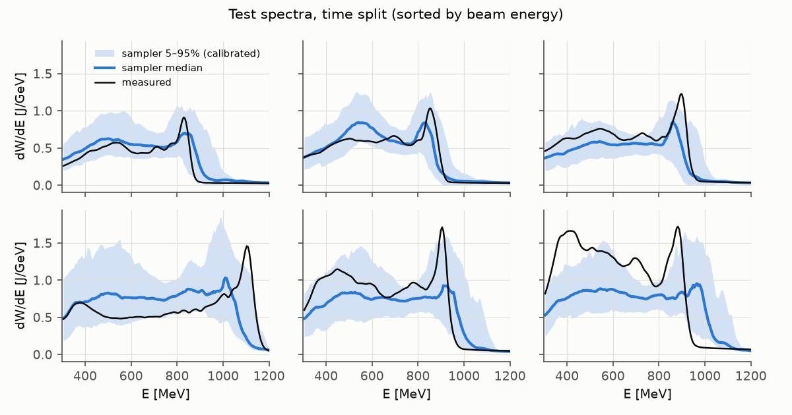
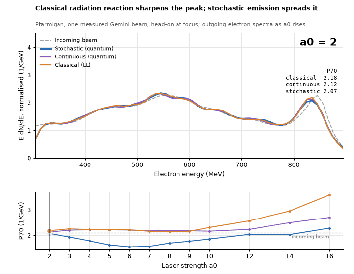
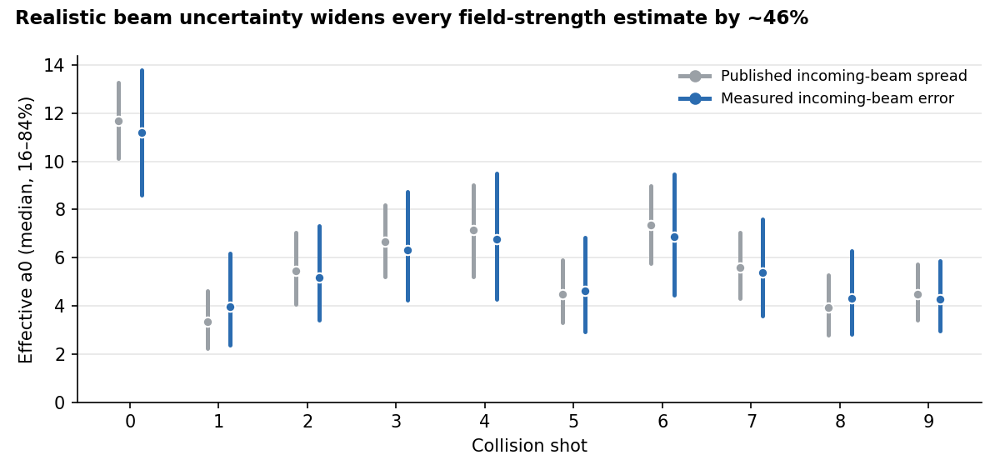
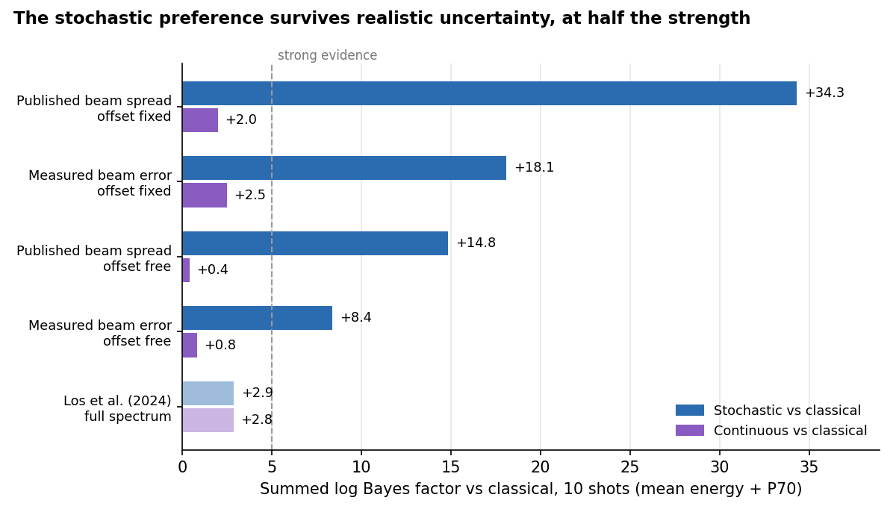

# ML-SFQED: calibrated beam models and fast inference for strong-field QED

Di Liu · November 2026 · code: this repository

## Summary

A calibrated beam model plus a neural surrogate of Ptarmigan turns a 19,200 CPU-hour Bayesian analysis of a strong-field QED experiment into 42 CPU-seconds per shot. Used on the 10 public collision shots of the 2021 Gemini radiation-reaction campaign, it shows two things:

- **The published per-shot beam uncertainty is about 3× too narrow.** Using the error measured on held-out shots widens the field-strength posteriors by about half and halves the model-comparison Bayes factors.
- **Spectral broadening favours stochastic quantum radiation reaction.** On every shot the outgoing spectrum is broader than the predicted incoming beam. Only stochastic emission reproduces this; classical and continuous models miss on 8 of 10 shots. The summed log Bayes factor over classical is +18 with realistic beam uncertainty (+8 with the transverse offset also free).

| Stage | Result |
| --- | --- |
| 1 Beam model | Spectral MSE 0.046 vs 0.057 for the published network; calibrated 90% intervals cover 0.89–0.90 |
| 2 Simulation | Ptarmigan v1.6.1 validated against analytic limits to ≤1%; 8,192-collision Sobol scan; 4,096 collisions repeated for classical and continuous radiation reaction |
| 3 Surrogate | MLP ensemble, R² 0.98 for energy loss at ~2× Monte Carlo noise; ~18,000× faster per call, ~4×10⁶× batched |
| 4 Inference | 42 CPU-s per shot; recovery test 90% coverage of the true a0 |

## Motivation

Radiation reaction is the recoil an electron feels from the light it emits. When a laser-wakefield electron beam meets a laser focused to normalised amplitude a0 ≈ 10–20, the quantum parameter χ reaches ~0.1–0.2. There classical, continuous-quantum and stochastic-quantum descriptions predict measurably different outcomes: in our scans the classical energy loss is 15–25% larger, and only stochastic emission broadens the spectrum.

The hard part is the incoming beam. Each shot's electron spectrum cannot be measured before the collision, so it is predicted from laser and plasma diagnostics, and that prediction error feeds straight into any claim about radiation reaction. Streeter et al. (2023) trained a neural-network ensemble to make these predictions and released the data. Los et al. (2024) used them to infer collision parameters and compare radiation-reaction models, at ~19,200 CPU-hours per inference.

This project asks: can a calibrated beam model plus a fast surrogate reproduce that inference cheaply, and is the beam uncertainty it relies on honest?

## Data

| Dataset | Content | Use |
| --- | --- | --- |
| Gemini 2021 LWFA (Streeter et al., [Zenodo 7510352](https://doi.org/10.5281/zenodo.7510352), CC BY 4.0) | 645 no-collision shots, runs 05–13 of 20 June 2021; diagnostics + measured electron spectra | Train and test the beam model |
| Los et al. collision data ([ELos385/RadiationReaction](https://github.com/ELos385/RadiationReaction)) | 10 collision shots: measured outgoing spectra, 100 network-predicted incoming spectra each, published model evidences | Inference and model comparison (fetched locally by `scripts/fetch_los2024.sh`, not redistributed) |

The beam drifts during the day: mean beam energy falls from 0.90 J to 0.52 J between runs 05 and 13. Two splits are used: the authors' random 570/75 split for direct comparison, and a **time split** (train runs 05–12, test run 13), the honest test for predicting a later collision shot.

## Stage 1: calibrated beam model

Each spectrum is total beam energy W times a normalised shape. log W comes from bagged LightGBM; the shape is a PCA continuum plus a Gaussian peak whose centre, width and height are regressed separately. The peak centre is predicted by the LightGBM ensemble averaged with a Gaussian process (RBF kernel, one length scale per feature): trees give step-like and the GP smooth predictions, so their errors differ. Blending was chosen on run 11 (trained on runs 05–10), where it cut the position error from 52 to 47 MeV; blending height or width did not help. Uncertainty comes from out-of-bag paired residuals, then per-bin split-conformal calibration.

| Split | Model | Spectral MSE | Beam-energy rel. RMS | 90% coverage (calibrated) |
| --- | --- | --- | --- | --- |
| paper | Streeter et al. network ensemble | 0.057 | 0.124 | – |
| paper | LightGBM ensemble | 0.056 | 0.149 | 0.88 |
| paper | Two-part | 0.050 | 0.123 | 0.89 |
| paper | Peak model | 0.048 | 0.124 | 0.89 |
| paper | **Peak model + GP position** | **0.046** | 0.124 | 0.89 |
| time | LightGBM ensemble | 0.040 | 0.189 | 0.91 |
| time | Two-part | 0.033 | 0.142 | 0.90 |
| time | Peak model | 0.032 | 0.146 | 0.90 |
| time | **Peak model + GP position** | **0.031** | 0.146 | 0.90 |

The figure shows the spectrum at the predicted peak parameters, which keeps 96% of the measured peak height on the held-out run; the per-bin median of samples keeps only 81%, because averaging over where the peak may sit flattens it (it scores a slightly lower MSE for the same reason). The remaining misses are mostly peak position (35 MeV RMS error).

Where the error lives: with the measured peak parameters the MSE would halve (0.034 → 0.017; before the GP blend), so the peak is what limits the model. Peak position is predictable (R² 0.69), height partly (0.43), width not at all (R² < 0). Correcting drift online, using earlier shots of the same run plus shrinking the width prediction (`scripts/peak_drift_study.py`, tuned on run 11, tested on run 13), cuts the width error by 13% and removes the parameter biases, but improves MSE by only 1%: the remaining error is shot-to-shot scatter that the diagnostics do not capture.

**Physics of the peak shape.** Every measured peak is asymmetric: a sharp high-energy edge and a long tail toward low energy. In the blowout regime the final energy maps from the injection history, dN/dE = (dN/dξ₀)/|dE/dξ₀|: the first-injected electrons pile up near the dephasing-limited maximum energy (ΔW ≈ (2/3) a0 m_e c² n_c/n_e, Lu et al. 2007), giving the edge, while electrons trapped later as the bubble evolves gain less, giving the tail. A Gaussian with an exponential low-energy tail fits the peak region of all 645 spectra with median R² 0.991, against 0.959 for the symmetric Gaussian used in the model (`scripts/peak_shape_study.py`). Using that shape in the beam model is a natural next step.

Raw bagged ensembles are overconfident (44–68% coverage of a nominal 90% interval) until calibrated. Shot-history and physics-ratio features gave no gain: the remaining error is independent shot-to-shot noise.

## Stage 2: Ptarmigan simulation

| Check | Expected | Ptarmigan |
| --- | --- | --- |
| Classical Landau–Lifshitz, a0 = 2–18 | analytic final γ | agrees to 1e-4 of the energy loss |
| Linear Compton yield, a0 0.5 vs 0.25 | ratio 4 (a0²) | 3.92 |
| Linear Compton energy loss vs LL | Klein–Nishina factor 0.952 | 0.943–0.947 |
| Quantum vs classical loss, a0 = 5, 10, 15 | below LL, falling with χ | 0.81, 0.74, 0.73 of LL |
| LMA vs LCFA rates | close at χ ≈ 0.1 | LMA 1–4% lower |

Production runs use LMA rates, stochastic quantum radiation reaction, no pair creation and 5,000 macro-electrons. The scan is a scrambled Sobol design over 10 inputs (a0 5–20, waist 2–3 µm, 35–55 fs, transverse offset 0–5 µm and angle, longitudinal offset ±250 µm sampled densely near focus, beam radius 0.5–2 µm, length 1–10 µm, divergence 1–4 mrad), with incoming spectra drawn from a pool of 1,935 beams (645 measured + 2 calibrated Stage 1 samples each). The first 4,096 collisions were repeated with classical (Landau–Lifshitz) and continuous (Gaunt-factor corrected) radiation reaction, same seeds. Observables follow Los et al.: mean energy above 305 MeV and P70 after 10 MeV smoothing, plus photon yield, energy, critical energy and angles.

## Stage 3: surrogate

A 5-member MLP ensemble (2 × 128 hidden units) on collision parameters plus beam descriptors (charge, energy, mean energy, 6 shape-PCA coefficients) and derived geometric features. Test collisions use incoming beams never seen in training (1,641 test, 967 calibration, 5,584 training runs).

| Observable | R² | RMSE | RMSE / MC noise | 90% coverage raw → calibrated |
| --- | --- | --- | --- | --- |
| Mean energy loss above 305 MeV | 0.979 | 3.1 MeV | 2.1 | 0.74 → 0.91 |
| Total energy loss | 0.985 | 3.2 MeV | 2.5 | 0.73 → 0.91 |
| Spread P70 | 0.79 | 0.16 | 2.0 | 0.79 → 0.92 |
| Photon critical energy | 0.983 | 0.9 MeV | 1.8 | 0.86 → 0.90 |
| log₁₀ photons per electron | 0.994 | 0.032 | 6.5 | 0.94 → 0.90 |

P70's lower R² reflects its small spread relative to Monte Carlo noise (the noise ceiling is ~0.95), not a worse fit. Holding out the band a0 > 16.5 raises the energy-loss RMSE to 4.6 MeV (LightGBM 8.8 MeV). Photon observables are still data-limited (error ∝ N^-0.65); electron observables have saturated near the noise floor.

**Uncertainty propagation.** For 114 held-out shots at a fixed collision (a0 = 12), 100 calibrated beam samples per shot through the surrogate: 11,400 evaluations in 0.08 s, against ~114 CPU-hours in Ptarmigan. Direct Ptarmigan runs on three shots match the surrogate's per-shot mean loss to within 3 MeV.

## Inference on the public collision shots

**Likelihood.** Gaussian on the outgoing mean energy above 305 MeV and P70; the incoming beam marginalised over 50 of the 100 predicted spectra; measurement error from the spectrometer's energy uncertainty (9–14 MeV) and 5% on P70; surrogate variance added. Free: a0, longitudinal offset dz and bunch length (as Los et al.), optionally the transverse offset. dz prior ∝ |dz|^-1/2 (near focus). emcee, 32 walkers × 8,000 steps.

**Recovery test.** On 48 held-out simulated collisions, the 90% interval contains the true a0 in 90% of cases and the true effective a0 in 83%.

**Beam uncertainty.** On held-out Gemini shots the incoming-beam prediction error is 0.29 in P70 and 18.8 MeV in mean energy, and the calibrated beam model's spread matches it (coverage 0.90–0.92). The published network's per-shot spread is ~3× smaller (median 0.11 and 6.4 MeV).

Only the effective field strength is constrained: offsets and bunch length stay prior-dominated, and a larger a0 at an offset gives the same energy loss.

## Radiation-reaction model comparison

Evidence by Monte Carlo integration over the prior (MC error ≤ 0.035 in log Z), one surrogate per model trained on the same collisions.

**Recovery test** (90 held-out simulated shots): with mean energy + P70, stochastic data are identified 93% of the time, classical 23% (60% go to stochastic), continuous 47%. With mean energy alone every model wins about a third of the time, because a free a0 absorbs the difference in energy loss.

| Set-up | Beam uncertainty | Observables | Continuous vs classical | Stochastic vs classical |
| --- | --- | --- | --- | --- |
| a0, dz, length | published | mean + P70 | +2.0 | +34.3 |
| a0, dz, length | measured | mean + P70 | +2.5 | +18.1 |
| + transverse offset | published | mean + P70 | +0.4 | +14.8 |
| + transverse offset | measured | mean + P70 | +0.8 | +8.4 |
| a0, dz, length | either | mean only | +0.9 | +1.0 |
| Los et al. (2024), full spectrum | published | PSIS-LOO | +2.8 | +2.9 |

Summed natural-log Bayes factors over 10 shots. Los et al.'s values are differences of their published per-shot log evidences, so the scale is comparable but not identical.

**Diagnosis of the P70 signal** (`scripts/diagnose_p70.py`):

1. *Not a definition artefact.* Simulation and data pipelines give the same P70 for the same spectrum (ratio 0.997); extra smoothing moves observed P70 by <3%; smearing with the spectrometer resolution leaves simulated classical P70 far above the observed values.
2. *Not out-of-distribution beams.* The predicted incoming beams sit inside the training pool (shape distance at the 4th–46th percentile).
3. *Not surrogate error.* Direct Ptarmigan runs at the fitted parameters agree with the surrogate to 0.1–0.3 in P70 and 1–5 MeV in mean energy.
4. *The physics.* Observed P70 is 0.72–0.93 of the predicted incoming value on all 10 shots. Fitting mean energy only and then predicting P70, stochastic reproduces it on every shot; classical and continuous predict a sharper or unchanged peak and miss on 8 of 10.

**Caveat.** Shots 8 and 9 show a 20–30% P70 drop with almost no inferred energy loss, which no model produces. Their loss is uncertain by ~19 MeV, so they are not decisive, but they show that incoming-P70 errors of this size occur. The published spread (0.11) ignores them and inflates the Bayes factors; the measured error (0.29) halves the preference.

**Beam chirp.** An energy chirp of ±0.2 or ±0.5 shifts mean energy loss by ≤0.4 MeV and P70 by ≤0.03, within Monte Carlo noise.

## Limitations and next steps

- **Two summary observables** constrain only the effective a0. A full-spectrum likelihood, with the incoming spectrum's shape error modelled explicitly, is the next step and the confirmation test for the stochastic preference.
- **Effective a0** is lower than Los et al.'s on most shots (3–7 vs their 7–13); the difference is not yet explained.
- **Fixed nuisances**: laser waist, duration, beam radius and divergence are fixed in inference.
- **Beam transfer**: the beam model is trained on 2021 no-collision shots and reaches the collision shots only through published predictions.

## References

- M. J. V. Streeter et al., *Laser wakefield accelerator modelling with variational neural networks*, High Power Laser Sci. Eng. 11, e9 (2023), [doi:10.1017/hpl.2022.47](https://doi.org/10.1017/hpl.2022.47); data [doi:10.5281/zenodo.7510352](https://doi.org/10.5281/zenodo.7510352).
- E. E. Los et al., *Observation of quantum effects on radiation reaction in strong fields*, Nature Communications, [doi:10.1038/s41467-025-67918-8](https://doi.org/10.1038/s41467-025-67918-8) ([arXiv:2407.12071](https://arxiv.org/abs/2407.12071)).
- E. E. Los et al., *A Bayesian framework to investigate radiation reaction in strong fields*, High Power Laser Sci. Eng. (2024), [doi:10.1017/hpl.2024.83](https://doi.org/10.1017/hpl.2024.83).
- W. Lu et al., PRL 96, 165002 (2006); PRSTAB 10, 061301 (2007) – blowout-regime fields and energy scaling.
- J. Wenz, S. Karsch, *Physics of Laser-Wakefield Accelerators*, [arXiv:2007.04622](https://arxiv.org/abs/2007.04622).
- T. G. Blackburn et al., Ptarmigan, Phys. Plasmas 30, 093903 (2023).
