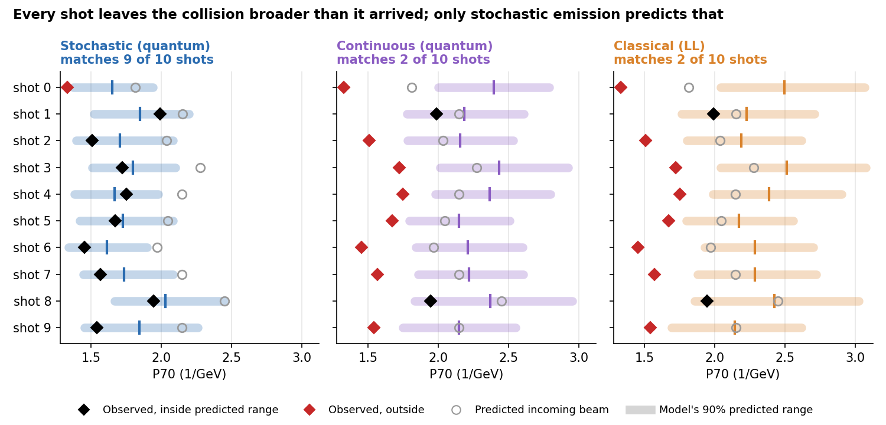

# Fast, calibrated inference for radiation-reaction experiments

Di Liu · November 2026 · two-page summary of [report.md](report.md) · code: [github.com/liudi23/ml-sfqed](https://github.com/liudi23/ml-sfqed)

**Abstract.** We build an end-to-end pipeline that takes raw data from a laser–electron collision experiment to Bayesian parameter estimation and model comparison: a machine-learning model of the incoming electron beam with calibrated uncertainty, Ptarmigan QED Monte Carlo, a neural surrogate of the simulation, and surrogate-based inference. Applied to the 10 public collision shots of the 2021 Gemini radiation-reaction experiment, it fits one shot in 42 CPU-seconds instead of ~19,200 CPU-hours. It shows that the published per-shot uncertainty on the incoming beam is about three times too small, and that the broadening of the electron spectrum favours stochastic quantum radiation reaction (summed log Bayes factor +20 over classical with realistic beam uncertainty).

## 1. Problem

When a laser-wakefield electron beam (~0.6 GeV) meets a laser focused to a0 ≈ 10–20, the electrons radiate a large fraction of their energy, and the recoil (radiation reaction) is in the regime where quantum effects matter (χ ≈ 0.1–0.2). Classical, quantum-continuous and quantum-stochastic models then predict different energy loss and different spectral shapes. Testing them is limited by two things: the incoming electron spectrum of a collision shot cannot be measured, only predicted from diagnostics; and each likelihood evaluation needs a full Monte Carlo simulation. Los et al. (2024) did this analysis with direct simulation (~19,200 CPU-hours per inference) and found the quantum models preferred.

## 2. Method

| Stage | What it does | Check on unseen data |
| --- | --- | --- |
| 1 Beam model | Predicts each shot's incoming spectrum from 58 laser/plasma diagnostics: total energy × (PCA continuum + physics-based peak), bagged LightGBM with a Gaussian process for the peak position, out-of-bag residuals and per-bin conformal calibration | Time split (train on earlier runs, test on the last run); 90% intervals cover 89–90% |
| 2 Simulation | Ptarmigan v1.6.1 (LMA rates), 8,192-collision Sobol scan over a0, timing, alignment and beam size, with incoming spectra from Stage 1; 4,096 collisions repeated for each of the three radiation-reaction models | Analytic limits (Landau–Lifshitz, linear Compton, Klein–Nishina) to ≤1% |
| 3 Surrogate | Ensemble of five MLPs mapping 23 collision and beam features to 9 observables; ensemble spread rescaled by split-conformal factors; one surrogate per radiation-reaction model | Held-out incoming beams: R² 0.98 for energy loss at ~2× the Monte Carlo noise |
| 4 Inference | Gaussian likelihood on the outgoing mean energy and P70 (a measure of peak sharpness), incoming beam marginalised over 50 predicted spectra; emcee posteriors; evidence by Monte Carlo over the prior | Recovery tests on simulated shots with known answers; posterior predictive checks |

The peak of the beam model is not a Gaussian but the shape expected from the physics of wakefield acceleration: electrons pile up below the dephasing-limited maximum energy E_max as (E_max − E)^(−1/2), smeared by resolution. This fits the 645 measured peaks 4.4× better than a Gaussian with the same three parameters, and its position is a physical quantity.

## 3. Results

**Beam prediction.** Spectral MSE 0.045 against 0.057 for the published network ensemble on the same split (0.030 on the harder time split), with calibrated intervals; raw ensembles cover only 44–68% of a nominal 90% interval. About 30% of each beam's energy sits in a broad secondary population that the diagnostics cannot predict, which sets the floor on the error.

**The published beam uncertainty is too narrow.** On held-out shots the incoming-beam error is 0.26 in P70 and 18.1 MeV in mean energy, 2.4–2.8× the per-shot spread of the published predictions. Propagating the measured error widens the field-strength posteriors by ~46% and lowers the stochastic-vs-classical Bayes factor by ~40%.

**Spectral broadening favours stochastic radiation reaction.** On all 10 shots the outgoing spectrum is broader than the predicted incoming beam. Fitting each model to the mean energy alone and predicting P70, only stochastic emission reproduces the broadening; classical and continuous models miss on 8 of 10. Direct Ptarmigan runs at the fitted parameters rule out surrogate error, and the effect is not a definition or out-of-distribution artefact.

| Beam uncertainty | Free parameters | Continuous vs classical | Stochastic vs classical |
| --- | --- | --- | --- |
| published | a0, timing, bunch length | +2.0 | +34.3 |
| measured | a0, timing, bunch length | +2.6 | +20.1 |
| measured | + transverse offset | +0.8 | +9.2 |
| Los et al., full spectrum | | +2.8 | +2.9 |

Summed natural-log Bayes factors over the 10 shots. Energy loss alone carries no model information (+1), because a free a0 absorbs the difference. On simulated shots the method identifies stochastic data 93% of the time.

**Field strength.** With two summary observables only the effective a0 (the field the electrons experience) is constrained: 4–7 on most shots, ~11 on the shot with the largest energy loss. Where the energy loss is clear, a direct simulation matches Los et al.'s effective ⟨ã0⟩ to about 1; on low-loss shots the electron data alone cannot pin a0, and Los et al. also used the gamma-ray signal.

## 4. What is new

- **Cost**: ~10⁶× cheaper inference, which makes recovery tests, extra free parameters (the transverse offset, previously fixed) and sensitivity studies routine.
- **Uncertainty that is measured, not assumed**: every learned component is calibrated and tested on data it never saw, and the incoming-beam error is taken from held-out shots. This changes the size of the physics conclusion.
- **A diagnosis of where the model evidence comes from**: spectral broadening (P70), not energy loss.
- **A physically interpretable beam model** that improves on the published one.

## 5. Limitations and next steps

The likelihood uses two summary observables; a full-spectrum likelihood with an explicit model of the incoming-shape error is the next step and the real test of the stochastic preference. The gamma-ray data are not yet used; adding them needs the spectrometer response modelled. Laser waist, duration, beam radius and divergence are fixed, and the surrogate is valid only within the simulated ranges (a0 5–20). The beam model is trained on no-collision shots and reaches the collision shots through published predictions.

**References.** M. J. V. Streeter et al., High Power Laser Sci. Eng. 11, e9 (2023) · E. E. Los et al., Nature Communications, doi:10.1038/s41467-025-67918-8; High Power Laser Sci. Eng. (2024), doi:10.1017/hpl.2024.83 · T. G. Blackburn et al., Phys. Plasmas 30, 093903 (2023) · W. Lu et al., PRSTAB 10, 061301 (2007).
